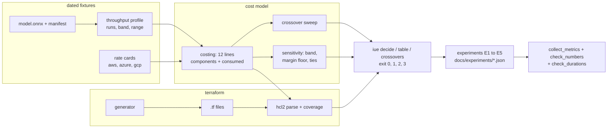
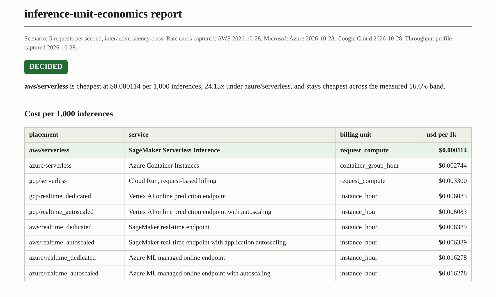
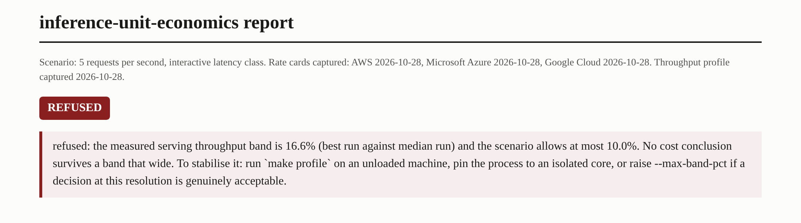

# inference-unit-economics

**Finds the traffic volume where each inference placement stops being the cheap
one, by measuring the one quantity no rate card can contain.**

[](https://github.com/GITHUB_USERNAME/inference-unit-economics/actions/workflows/ci.yml)

A cloud rate card is denominated in what the provider sells (instance hours,
container group hours, rounded request milliseconds) and the work is denominated
in requests. Relating the two takes the one curve no rate card can contain,
because it belongs to your model and your traffic: how many requests an hour of
capacity actually serves, and how long one request actually runs. So no
published pricing can tell you what your model costs to serve. This repository
measures a local throughput profile once, treats it as a dated input with an
error band, and derives what the pricing page structurally cannot: dollars per
thousand inferences, per placement, per provider, and the request volumes where
the cheap choice changes. Questions it answers that a pricing page cannot:

1. At your traffic, which placement is cheapest, by how much, and does that
   answer survive the noise in the throughput measurement it rests on?
2. Where are the crossovers, and are they even a property of your model?
3. How much of each bill is work, and how much is rounding, payload, or setup?
4. How much of the bill can the Terraform that provisions the placement
   represent at all?

## The numbers the tool would rather not have produced

- **The crossover is not a property of the model.** For the same measured
  workload, the serverless to autoscaled flip is a **crossover at 9.2 requests**
  per second on GCP and a **flip at 280.9 requests** per second on AWS:
  **30.5x apart**, and nothing the model does moves it. The gap decomposes
  exactly: a **1.05x instance price** difference times a **29.0x per request**
  cost difference. The second term is the billing increments' 100x pulled
  down by Cloud Run's cheaper billed millisecond and by an AWS payload fee
  that outweighs its compute, then pushed part of the way back up by GCP's
  request fee. On Azure the flip never arrives in
  the swept range.
- **A fast model is billed for the rounding, not the work.** The committed model
  sustains **93,104 single row requests** per second per process, so one request
  finishes far inside either provider's billing increment. The billed duration
  runs **93x on SageMaker** Serverless and **9,310x on Cloud Run** against the
  measured service time; since fees are not inflated, that lifts the SageMaker whole bill
  **1.53x** and the Cloud Run **bill to 8.2x** what the unrounded formula
  would charge. On SageMaker the payload's data processing fee costs
  **1.8 times the compute**.
- **The cheapest line is almost no work at all.** Batch wins the deferred table
  outright, and its bill has a **setup share of 98.66%**: the billed 120 second
  setup window dwarfs the work, which finishes in moments at
  **306,284 rows per second** (batch size 128).
- **The measurement argues back.** On the shared capture machine, single row
  throughput varied by **46.2%** (best run minus worst, over the median) across
  **25 short trials**; the decision band (best against median) is a **band of
  16.6%**. The
  tool refuses to decide (exit 2) whenever that band exceeds the scenario's
  ceiling, and around each crossover there is a zone, **a 1.21x span** of
  traffic (the declared margin floor applied on both sides of the flip), where
  the honest answer is exit 1: no winner clears the floor there.

At the reference scenario of 5 requests per second, interactive, the **cheapest
is aws/serverless** at **$0.11 per million** inferences with a **margin of
24.13x** over the runner up, and across both latency
classes the full table spans **4,400x the cost** from cheapest line (a batch
job) to dearest, **143.1x within the** interactive lines alone. Every bold figure above is produced by code in this
repository, re-measured by `make verify`, and guarded against the prose by
`tools/check_numbers.py`: **169 tests**, **98.0% line coverage**, rate cards and
profile **both captured 2026-10-28**.

## Quickstart

Prerequisites: Python 3.11+, no network at runtime, no cloud account, no keys.

```bash
git clone https://github.com/GITHUB_USERNAME/inference-unit-economics.git
cd inference-unit-economics
python3 -m pip install -e ".[dev]"

iue decide                 # the headline verdict, with its exit code
iue table --latency deferred
iue crossovers
iue coverage               # what the Terraform cannot represent
make verify                # lint + tests + receipts, offline
```

`iue decide --providers gcp --traffic-rps 9.2` lands inside the undecided zone
and exits 1. `iue decide --max-band-pct 10` tightens the band ceiling below what
this machine measured and watches the tool refuse with exit 2.

## The decision, and when the tool declines to make one

`iue decide` names a winner only when two conditions hold at once: no throughput
inside the measured band changes the leader, and the leader wins by at least the
declared 1.10x margin floor. Around the GCP crossover that zone runs **between
8.38 and** **10.14 requests** per second, and the same 1.21x shape sits around
the AWS flip. A team asking "which one" inside that zone is told, with exit
code 1, that either choice is defensible, which is a more useful answer than a
coin toss wearing a verdict.

Two placements can also tie to the dollar: at the autoscale floor, an autoscaled
endpoint and a dedicated one are the same spend wearing two names, and the tool
reports them as co-winners rather than pretending one beat the other.

## Where the cheap choice changes

| Volume (requests per second) | Below | Above |
| --- | --- | --- |
| **crossover at 9.2 requests** (GCP only) | gcp/serverless | gcp/realtime_autoscaled |
| **above 120.7 requests** (all providers, interactive) | aws/serverless | azure/serverless |
| **flip at 280.9 requests** (AWS only) | aws/serverless | aws/realtime_autoscaled |

The second row is the taxonomy's own finding: past that volume the cheapest
"serverless" line is Azure Container Instances, which is serverless in
provisioning and dedicated in billing, a small always on box that outruns per
request billing. ADR-004 takes that apart.

## What the bill is made of

Per request offers bill a rounded duration: 1 ms increments on SageMaker
Serverless, 100 ms on Cloud Run. A model faster than the increment pays for the
rounding (**93 times its service** rate on SageMaker, **9,310 times for the**
same work on Cloud Run), and once compute rounds down to almost nothing, the
fees that never appear in a comparison table take over: on SageMaker the payload
costs **1.8 times the compute**, and the cheapest batch bill is **98.66% setup**.
E2's component breakdown in `docs/experiments/` carries every line.

## What the Terraform cannot represent

The cost model tags every priced line with the quantities its formula consumed.
E5 generates real HCL per provider, parses it back, and maps each quantity
against the files: the definitions hold **162 attribute paths**, yet of **the
23 quantities the** bill consumes they **represent 6 of them**. The **other 17
have no** possible home in any resource schema in use: prices, traffic,
durations, increments, and the batch job's setup window. And **3 of the 12**
placements, the batch placement on every provider, have no resource block at
all, a count the coverage map computes from the generator's own manifest
against the parsed files, because a batch job is an API call with a lifetime
rather than infrastructure. The infrastructure definition can be complete and
the cost still is not in it, which is the unit mismatch this repository exists
to make countable. `iue coverage` prints the split; ADR-002 names exactly what a
real `terraform plan` would and would not add.

## The bugs the measurement found

**The stable looking harness was measuring luck.** The first harness timed a
fixed item count per trial, which finished in about 43 milliseconds and produced
a tidy spread. Trials stretched to a second showed run to run variation of a
quarter on the shared capture machine: a long window almost always contains a
neighbour stall, and short windows had been dodging them by chance. The fix is
the estimator in ADR-003: best of many short trials for capacity, best against
median as the decision band, the full run list committed, and the worst case
range (it **varied by 46.2%**, best minus worst over the median) published
rather than hidden.

**A coin toss wore a verdict.** The first decision rule tested only the band, so
at the GCP crossover it printed a winner with a lead of a third of one percent:
two flat lines, no throughput flip, "decided". The margin floor exists because
of that run, and `tests/test_crossover_and_sensitivity.py` reconstructs the
exact shape and asserts the tool now declines.

**Ties made deciding impossible, then a dead heat crashed it.** Treating a
floored autoscaled endpoint and its dedicated twin as winner and runner up held
the margin at 1.00x forever, so no single provider question could ever be
decided; making identical lines co-winners then exposed the knife edge case
where every line ties exactly on a crossover, which the first fix raised as an
error instead of reporting as the most undecided answer there is. Both are
pinned in the suite, and the E4 zone bisection that flushed them out had its own
inverted branch, caught because the zone printed with no upper half.

## Architecture





## Evidence



The screenshot is taken by `tools/capture_screenshots.py` from the real report
`iue report` writes, framed by heading rather than pixel offset, and the tool
reads back the computed style of the verdict badge and fails if it is invisible.
The refused report (`--max-band-pct 10`) is shot the same way:




The recording is a replay, not a screen recording: every line of terminal text
is real captured stdout and stderr, revealed at the pace of each command's
measured wall time, and `docs/video/manifest.json` lists every command with its
exit code. The pacing durations live only in that manifest, labelled as
published nowhere.

## The fixtures, including the awkward parts

- `fixtures/model/`: a small gradient boosted pipeline on a seeded synthetic
  task, exported to ONNX, with a manifest pinning the sha256 the runtime
  refuses to load without. Boring on purpose: the subject is the cost model,
  and the unit of work only has to be real, CPU reproducible, and identical
  bytes for everyone.
- `fixtures/throughput/profile.json`: the measurement of record, with every run
  of every trial committed, including the stalled ones that put the worst case
  range at nearly half the median. Nothing about the noise is edited out, and the loader
  refuses a profile whose summary disagrees with its own runs.
- `fixtures/rate_cards/`: dated, sourced, schema checked. The awkward entry is
  Azure's serverless placement, which is billed while running rather than per
  request; the card says so and the model prices it that way.

## What this repository cannot measure

Cold starts, autoscaler lag, egress, negotiated discounts, and the cloud
instances themselves: the profile measures the capture machine, and the vCPU
scaling assumption is the strongest one in the model. ADR-005 lists every
declared input and names the one claim that genuinely needs a cloud account,
and the E4 sensitivity machinery exists so a reader can price how far any of it
would have to be wrong before a decision flips. Cold starts in particular make
the serverless lines worse at exactly the low volumes where they win this
table, so the published crossovers are a floor on the instance placements'
competitiveness, not a ceiling.

## Layout, exit codes, reproduction

```
fixtures/            model.onnx, throughput profile, rate cards (all dated)
src/inference_unit_economics/
  model/             onnx runtime wrapper (strict), fixture builder (train extra)
  bench/             harness (make profile) and the strict profile loader
  costmodel/         rate cards, costing, crossover, sensitivity
  tfgen/             HCL generator, hcl2 parser, coverage map
  serving/           FastAPI arm and the batch job runner
  cli.py             iue: decide, table, crossovers, coverage, report, profile
terraform/           generated, committed, diffed in CI
experiments/         E1 to E5, JSON to docs/experiments/
tools/               collect_metrics, check_numbers, check_durations, evidence
```

| Exit | Meaning |
| --- | --- |
| 0 | Decided: the winner survives the measured band and clears the margin floor. |
| 1 | Evaluated, not decided: the lead flips inside the band, or is thinner than the floor. Either choice is defensible. |
| 2 | Refused: the band exceeds the scenario ceiling, or the profile cannot be trusted. The question is unanswerable from this measurement. |
| 3 | Tool error. |

`make verify` runs lint, the suite, the experiments and the receipts from a
fresh clone with no network at runtime. `tools/check_numbers.py` verifies every
figure in this README, the defense guide and the ADRs against
`docs/metrics.json` by anchor phrase rather than bare digits, sweeps for numbers
nothing re-measures, and `make prove` breaks a figure on purpose so you can
watch it fail. `tools/check_durations.py` holds the no published durations rule
across every tracked file. Coverage counts the default path; the fixture
builder, which needs the train extra, is excluded from the denominator and that
exclusion is disclosed here.

## Stack

| Technology | Role here | Why this one |
| --- | --- | --- |
| ONNX Runtime | The unit of work | A committed artifact every machine runs identically, with threads pinned so the profile is a per process rate the model can scale. |
| scikit-learn + skl2onnx (train extra) | Builds the fixture once | The model must be boring; the subject is the bill. |
| python-hcl2 | Parses the generated Terraform | The coverage map needs the files as data, not as a deploy. |
| Terraform HCL (generated) | The artifact under audit | E5's finding is about what this format can hold. |
| FastAPI | The per request serving arm | The batch route must genuinely amortise, and tests hold the two routes to row for row agreement. |
| NumPy | The arithmetic | Profile statistics and the batch job. |
| Pytest, Ruff, GitHub Actions | The usual discipline | Three Python matrix, coverage floor, fixtures diffed, receipts re-measured in CI. |

ADRs: [dated rate cards, not live pricing](docs/adr/ADR-001-dated-rate-cards-not-live-pricing.md) ·
[Terraform generated and parsed offline](docs/adr/ADR-002-terraform-generated-and-parsed-offline.md) ·
[the duration trap](docs/adr/ADR-003-the-duration-trap.md) ·
[the placement taxonomy](docs/adr/ADR-004-placement-taxonomy.md) ·
[what this repository cannot measure](docs/adr/ADR-005-what-this-repository-cannot-measure.md)

## The Pivot, and future work

**Deliberately out of scope: deploying the winning placement.** The trigger is
exit 0 with a saving that clears the migration cost at your traffic, which this
tool computes instead of putting on a roadmap. Until a decision is worth real
spend, the honest artifact is the comparison, its band, and its refusals.

A second version would want, in order: a profile taken on the candidate
instance types rather than the local machine (the design already treats the
profile as a swappable dated input); cold start measurement behind a flag for
anyone with an account; and per request billing fixtures for more regions. The
first metric to watch after any of that: whether the GCP crossover moves out of
single digit requests per second, because everything a small team would decide
differently lives on that side of it.
